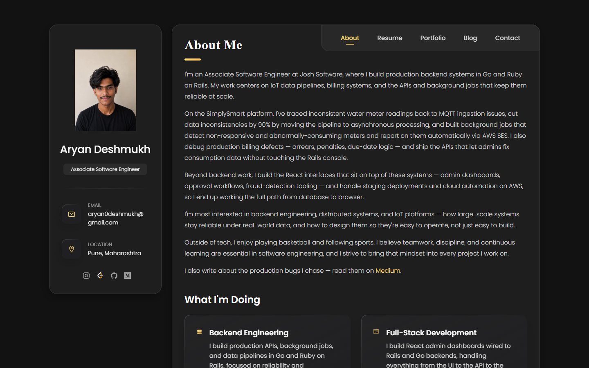
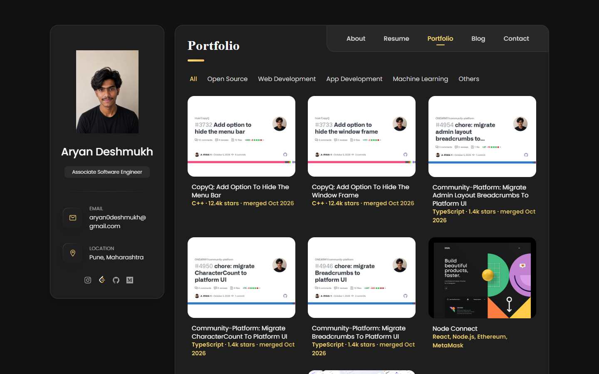
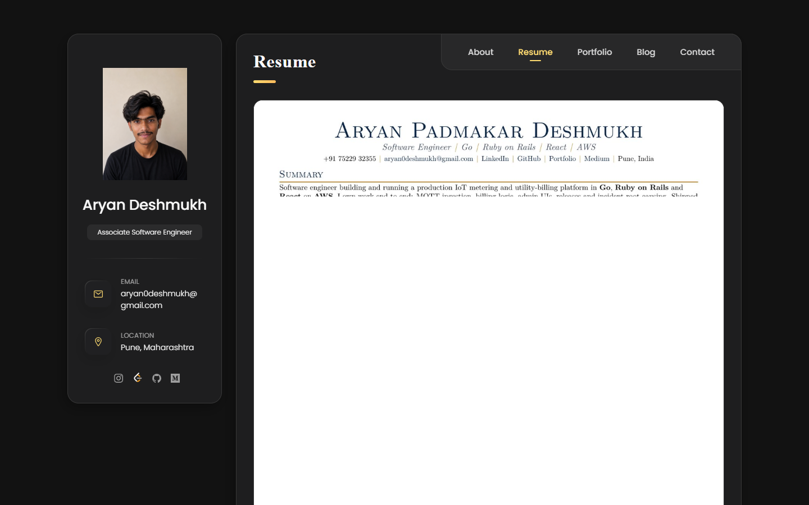
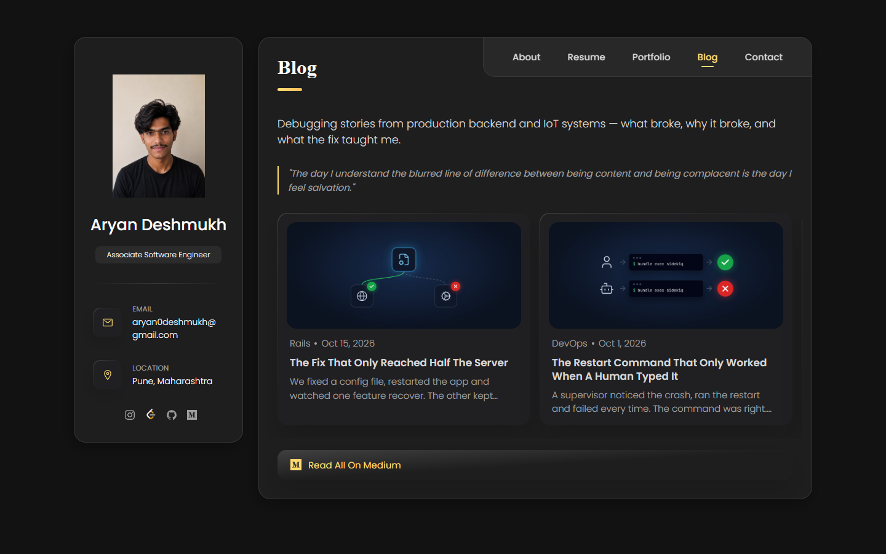
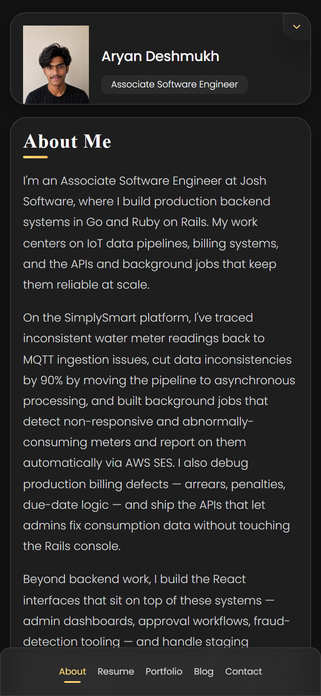
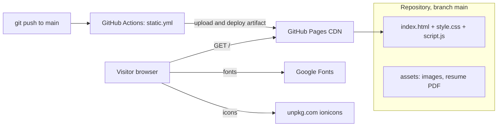
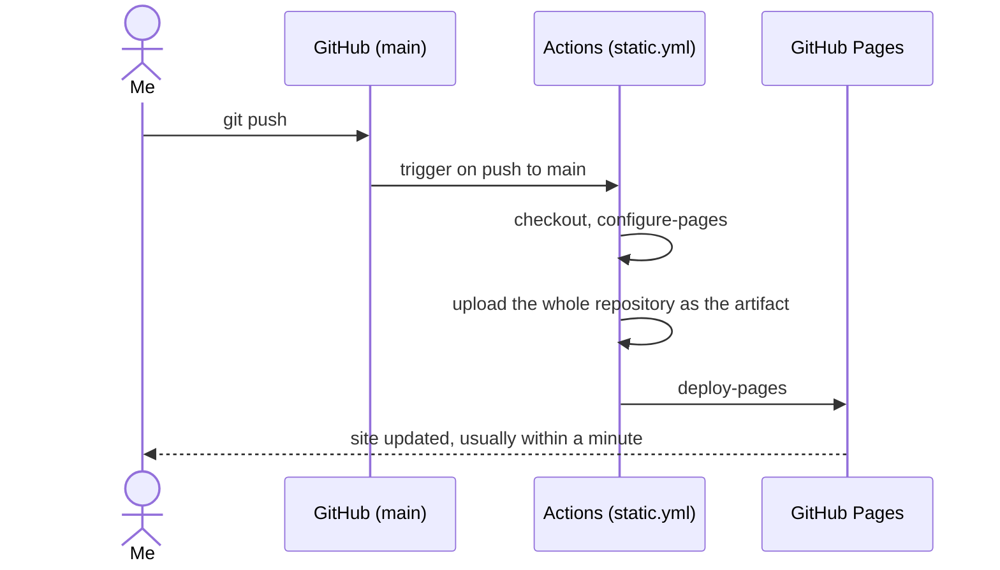

<h1 align="center">Portfolio-Website</h1>

<p align="center">
  The personal site of Aryan Deshmukh, a backend engineer: projects, merged open-source work, blog posts and the current resume.<br>
  One static page, no build step, deployed to GitHub Pages on every push to <code>main</code>.
</p>

<p align="center">
  <a href="https://a-ryan-1.github.io/Portfolio-Website/"><strong>Live site</strong></a>
  &middot;
  <a href="#try-it-live">Try it</a>
  &middot;
  <a href="#how-it-works">How it works</a>
  &middot;
  <a href="#run-it-locally">Run locally</a>
  &middot;
  <a href="#deployment">Deployment</a>
</p>

<p align="center">
  
  
  
  
</p>

<p align="center">
  <a href="https://a-ryan-1.github.io/Portfolio-Website/">
    
  </a>
</p>

<p align="center"><sub>Last updated: 2026-10-16 &middot; Live on a free tier (GitHub Pages)</sub></p>

---

## Contents

- [About](#about)
- [Try it live](#try-it-live)
- [Features](#features)
- [Why it exists](#why-it-exists)
- [How it works](#how-it-works)
- [Engineering quality](#engineering-quality)
- [Run it locally](#run-it-locally)
- [Environment variables](#environment-variables)
- [Deployment](#deployment)
- [Status and roadmap](#status-and-roadmap)
- [Credits](#credits)

## About

A recruiter or interviewer who has my resume wants the next thing within a minute: the work behind it, the code, the writing. This site is that page. Every project card links to its repository and live demo, every open-source card links to the merged pull request, and the Resume tab shows the same PDF I send with applications.

It is deliberately small: five tabs on one HTML page, plain CSS and about 150 lines of JavaScript, so it loads fast, has nothing to keep patched and can be read end to end in a few minutes.

## Try it live

Open **https://a-ryan-1.github.io/Portfolio-Website/**. No login, nothing to install.

Things to try in the first two minutes:

1. On **Portfolio**, click **Open Source**: the cards are merged pull requests in projects with over a thousand stars, each linking to the PR.
2. Click **Web Development** or **Machine Learning**: the filter narrows the cards without a page reload.
3. Open **Resume**: the current PDF is embedded as a preview and can be downloaded.
4. Open **Blog**: the engineering posts, each card linking to the Medium story.
5. Resize the window or open it on a phone: the sidebar collapses into a header and the grids reflow.

<table>
  <tr>
    <td width="50%"><p align="center"><sub>Portfolio tab with category filters (<a href="#how-it-works">how it works</a>)</sub></p></td>
    <td width="50%"><p align="center"><sub>Resume tab, the same PDF as in applications (<a href="#deployment">how it is updated</a>)</sub></p></td>
  </tr>
  <tr>
    <td width="50%"><p align="center"><sub>Blog tab (<a href="#how-it-works">how it works</a>)</sub></p></td>
    <td width="50%"><p align="center"><sub>Phone layout (<a href="#engineering-quality">measured</a>)</sub></p></td>
  </tr>
</table>

Screenshots are of the live site, taken 2026-10-16 at 1440x900 (phone: 390x844).

## Features

- **Five tabs on one page**: About, Resume, Portfolio, Blog, Contact, switched in the browser without loading another page.
- **Filterable project grid**: All, Open Source, Web Development, App Development, Machine Learning, Others; a dropdown replaces the buttons on small screens.
- **Merged open-source work**: one card per merged pull request with a preview image and the repository's language and star count.
- **Resume tab**: the current resume PDF, previewed and downloadable, plus a download link on the Contact tab.
- **Blog tab**: a card per published post, linking to Medium.
- **Responsive layout**: profile sidebar on desktop, collapsible on mobile.
- **Share previews**: Open Graph and Twitter card tags, so a link pasted in a chat shows a title, a description and a photo.

## Why it exists

Every application and every talk proposal needs one link that shows the work rather than describing it. I wanted that link to be something I fully control and can read in five minutes, so it is plain HTML, CSS and JavaScript on a free host. That is also why the open-source and blog tabs are generated from real, linked evidence and not typed by hand.

## How it works



What happens on a push to `main`:



There is no build: the repository is the site. Tab switching and the project filter are a few dozen lines of DOM code in `assets/js/script.js` that toggle an `active` class; every card is plain HTML in `index.html`.

### Tech stack

| Layer | Technology |
|---|---|
| Markup | One HTML5 page, semantic sections per tab |
| Styling | Plain CSS in `assets/css/style.css` (custom properties, grid, flexbox) |
| Behaviour | Vanilla JavaScript, no framework, no bundler |
| Fonts and icons | Poppins from Google Fonts; Ionicons 5.5.2 from unpkg |
| Hosting | GitHub Pages |
| Deploy | GitHub Actions (`.github/workflows/static.yml`) |

### Design decisions

1. **No framework and no build step.** The site is content, not an app. Trade-off: every card is hand-edited or generated HTML, with no component reuse.
2. **Cards are generated from evidence, not typed.** Open-source cards come from merged PRs and blog cards from published posts, produced by scripts that live outside this repository and paste HTML into `index.html`. Trade-off: the generated blocks must not be edited by hand, or the next run overwrites them.
3. **The repository root is the deploy artifact.** The workflow uploads everything, so `docs/` and the README are also served. Trade-off: nothing private may ever be committed here.
4. **Template as a starting point.** The layout started from an open-source vCard portfolio template; content, structure and styling since then are mine. Trade-off: some CSS is more verbose than it needs to be.

<details>
<summary><strong>Project structure</strong></summary>

```
index.html                 the whole site: five tabs, every card
assets/
  css/style.css            all styling
  js/script.js             tab switching, project filter, modal
  images/                  photo, project, blog and open-source images, icons
  Aryan_Deshmukh_Resume.pdf   the current resume, shown in the Resume tab
docs/images/               README screenshots only
.github/workflows/static.yml   deploys to GitHub Pages on push to main
```

</details>

## Engineering quality

| Area | What is in place |
|---|---|
| Tests | None. The site has no logic beyond tab and filter toggles; see Known limitations |
| CI | One workflow deploys on every push to `main` (`static.yml`); it does not lint or test |
| Security | Static files only: no forms, no server, no cookies, no secrets; external links use `rel="noopener noreferrer"` |
| Content check | The text is checked against a list of private names before every push, and every claim is traced to a recorded source |
| Lighthouse, live, mobile preset (2026-10-16, before the avatar fix) | Performance 65, Accessibility 96, Best Practices 100, SEO 92 |
| Lighthouse, live, desktop preset (2026-10-16, before the avatar fix) | Performance 59, Accessibility 96, Best Practices 100, SEO 100 |
| Lighthouse, local, mobile / desktop, after the fix (2026-10-16) | Performance 84 / 91, Accessibility 96, Best Practices 100, SEO 100 |

The largest-contentful-paint element was the profile photo: a 1.6 MB PNG shown at 80 px wide. Replacing it with a 400 px JPEG (18 KB) took local mobile performance from 67 to 84 and desktop from 89 to 91. The live scores above are re-measured after the fix is deployed.

Run the same measurement:

```bash
npx lighthouse http://localhost:8000/ --only-categories=performance,accessibility,best-practices,seo --view
```

## Run it locally

Works on Windows (Git Bash), macOS and Linux. You need **Python 3** (any recent version, for the static file server) or any other static server; there is nothing to install.

```bash
git clone https://github.com/A-RYAN-1/Portfolio-Website.git
cd Portfolio-Website
python3 -m http.server 8000
```

It is ready when this returns `200`:

```bash
curl -s -o /dev/null -w "%{http_code}\n" http://localhost:8000/
```

Open http://localhost:8000/. Fonts and icons load from the internet, so an offline run shows fallback fonts and no icons.

<details>
<summary><strong>Other static servers</strong></summary>

`npx serve .` or the VS Code Live Server extension work the same way. Opening `index.html` straight from the disk also works, since no part of the site needs a server, but a server matches production.

</details>

## Environment variables

None. The site is static and reads no configuration, so there is no `.env` file and nothing secret in the repository.

## Deployment

The site is hosted on **GitHub Pages** (free). Every push to `main` runs `.github/workflows/static.yml`, which uploads the repository as the Pages artifact and deploys it. A manual run is possible from the Actions tab (`workflow_dispatch`).

| Part | Host | Deploys | Variables the host needs |
|---|---|---|---|
| The whole site | GitHub Pages | automatically on push to `main` | none |

Free-tier limits a visitor or I would notice (checked 2026-10-16): GitHub Pages serves public repositories for free with a soft limit of 100 GB bandwidth per month and a 1 GB site size; the site is well under both. A change appears about a minute after the workflow finishes.

The resume PDF and its preview image on the Resume tab are replaced by a script whenever a new resume version is released, followed by a normal push.

<details>
<summary><strong>Recreate the deploy from nothing</strong></summary>

1. Fork or push the repository to GitHub.
2. In Settings, Pages, set the source to **GitHub Actions**.
3. Push to `main`, or run the workflow from the Actions tab.
4. The site is at `https://<user>.github.io/<repository>/`. Because the URL includes the repository name, renaming the repository changes the URL and GitHub does not redirect it.

</details>

## Status and roadmap

**Reached:** live on a free tier. URL opens and every tab and the project filter work (checked 2026-10-16); Lighthouse measured the same day.

**Known limitations**

- No automated tests and no lint step; checks are manual.
- Accessibility is 96, not 100: Lighthouse flags links inside text that are told apart by colour only.
- The Portfolio tab is one long list of cards and has no search.
- The contact tab is links only (email, GitHub, LinkedIn, Medium); there is no form, on purpose.
- Fonts and icons come from third-party CDNs, so the page looks plainer offline.

**Planned**

- [ ] Re-measure Lighthouse on the live URL after the avatar fix is deployed and record it here
- [ ] Fix the colour-only link style flagged by Lighthouse
- [ ] Self-host the font and icons to drop two third-party requests
- [ ] Add a link checker to the deploy workflow
- [ ] Move to a shorter URL (`a-ryan-1.github.io`) by renaming the repository, with the resume and LinkedIn updated together

## Credits

Built and maintained by [Aryan Deshmukh](https://github.com/A-RYAN-1). The layout started from the open-source vCard personal portfolio template by [codewithsadee](https://github.com/codewithsadee); the content, the structure of the tabs and everything added since are my own work.
